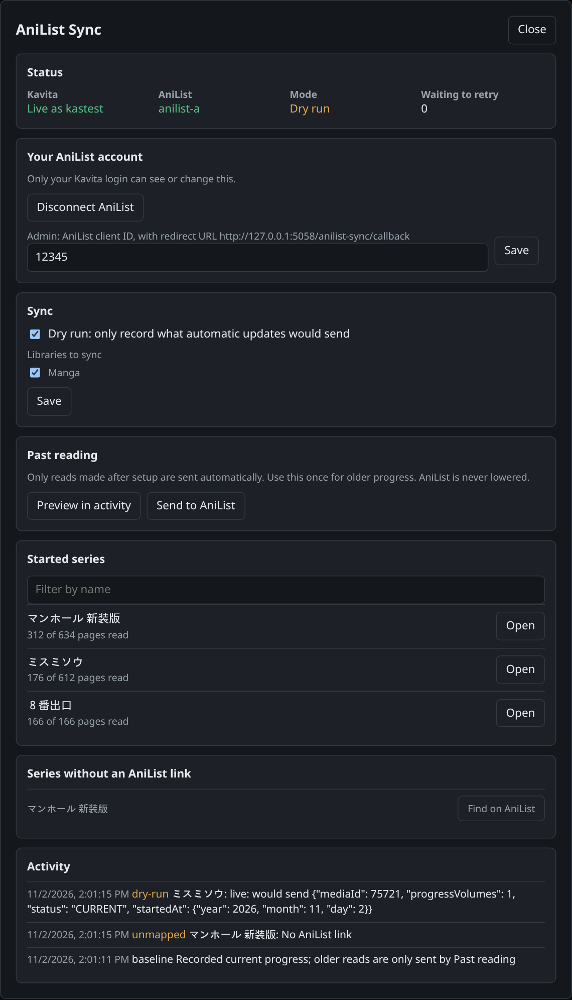
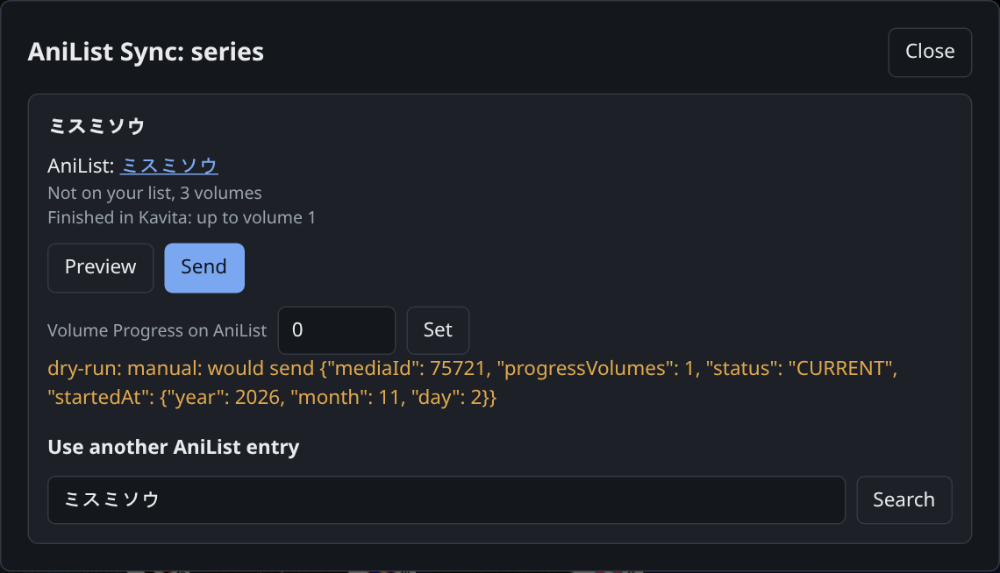

# Kavita AniList Sync

Updates each Kavita user's AniList list as soon as they finish a manga or light novel volume, without Kavita+.

A button inside Kavita opens the panel. Logging in to Kavita is the only login: each user connects their own AniList account and can only see and change their own settings. The service reads from Kavita with that user's key and never changes Kavita's data.

## Screenshots

The **AL** button in Kavita's top bar opens the panel:




Each series page has its own button, to preview, send, edit volume progress or change the AniList entry:



## Setup

1. In `docker-compose.yml`, set `KAVITA_URL` and put your Kavita host name in `ALLOWED_HOSTS`, then run `docker compose up -d --build`.
2. Route `/anilist-sync/` to the service on the same host name as Kavita. With nginx, `^~` keeps file-extension rules from taking over:

   ```nginx
   location ^~ /anilist-sync/ {
       proxy_pass http://127.0.0.1:8091/;
       proxy_set_header Host $host;
   }
   ```

3. Load the panel in Kavita. It has to be added to `index.html` each time the container is recreated; `injector/kavita-anilist-sync.sh` does this as a start-up step.
4. As a Kavita admin, open the panel and create a client at [AniList developer settings](https://anilist.co/settings/developer) with the redirect URL shown there. Save its ID.
5. Each user opens the panel, uses **Connect AniList**, selects libraries and reads a volume. When **Activity** looks right, they turn off **Dry run**.

An admin must have opened the panel once, because Kavita only sends live progress events to admin connections.

## Rules

- Automatic updates never lower AniList, and leave `COMPLETED` and `DROPPED` entries alone.
- The series dialog can set Volume Progress to any number, including a lower one. It stays there until you finish a new volume or use **Send**.
- A volume counts when its last page is opened.
- Volume progress comes first. Chapter progress is only sent for series without volumes.
- Files Kavita treats as specials count when their name is only the series name plus a number, like `世界鬼（４）`. A standalone book counts as volume 1.
- A `FINISHED` series becomes `COMPLETED` when AniList knows its total and you reach it.
- Series match through an `anilist.co/manga/<id>` link in their Kavita metadata, such as the ones [Komf](https://github.com/Snd-R/komf) writes. Users can also link a series themselves; that link stays in this service.
- Only reads made after setup are sent. **Past reading** sends older progress.

## Security

Every API call needs a valid Kavita session, which Kavita itself verifies. AniList tokens and Kavita keys live in `data/sync.sqlite` and are never sent to the browser.

## Tests

```bash
pip install -r requirements-dev.txt
PYTHONPATH=. pytest tests/test_progress.py
```

`tests/e2e.py` needs a disposable Kavita and uses a local AniList stand-in; its header lists the variables.
